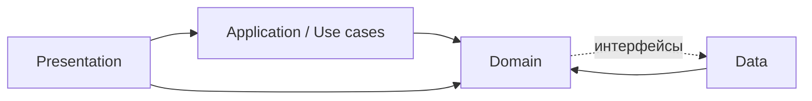
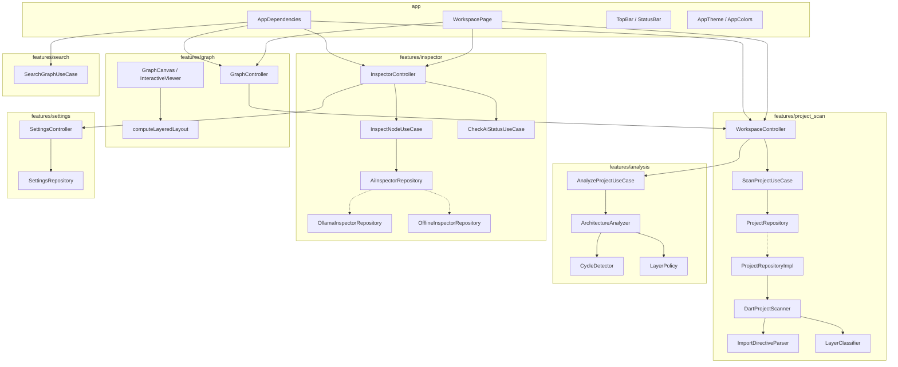
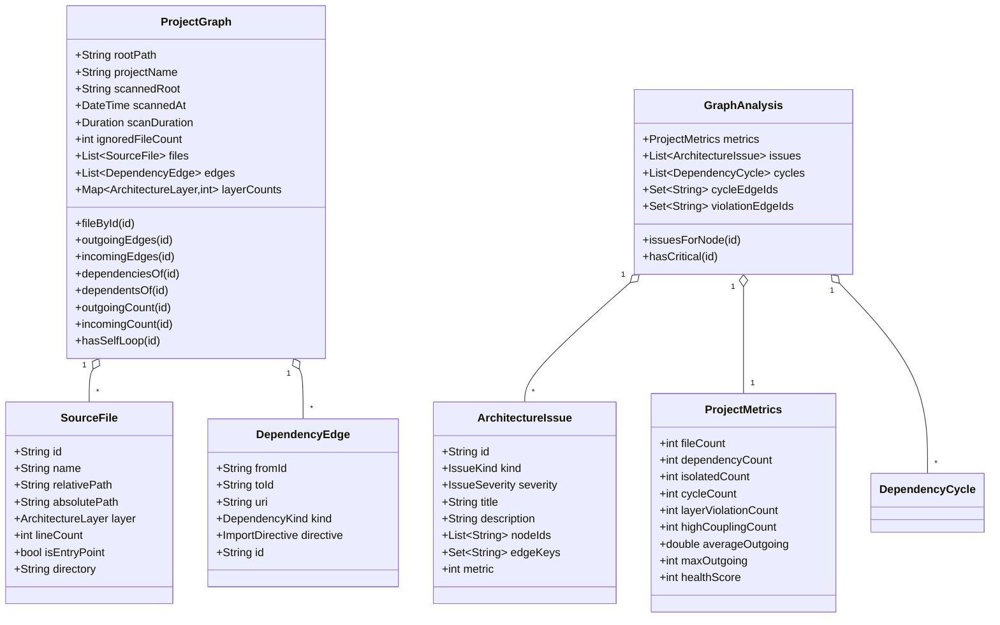
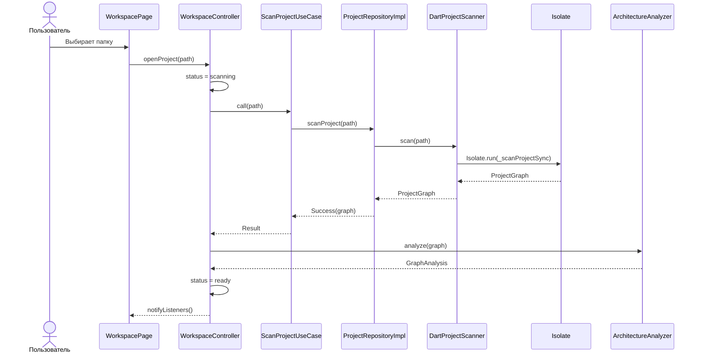
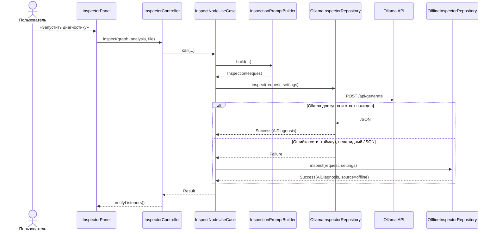

# Пояснительная записка: главы реализации

**Тема:** разработка десктопного приложения для графового анализа архитектуры
Dart/Flutter-проектов с локальным ИИ-инспектором.

**Программный продукт:** CodeGraph, версия 1.0.0.

**Платформа:** Flutter Desktop (macOS, Windows, Linux).

---

## 1. Общие сведения

### 1.1 Актуальность

По мере роста Flutter-проекта зависимости между файлами перестают быть очевидными:
появляются циклические импорты, Presentation начинает напрямую обращаться к Data,
а часть файлов оказывается мёртвым кодом. IDE помогает перейти к определению,
но не показывает архитектуру целиком и не объясняет, какие связи нарушают выбранную
архитектурную модель.

Существующие инструменты либо ориентированы на другие языки, либо требуют отправки
кода во внешний сервис, либо строят статическую картинку без возможности исследования.
CodeGraph решает три задачи одновременно:

1. строит интерактивный граф зависимостей;
2. автоматически находит архитектурные аномалии;
3. объясняет их локальной языковой моделью, не передавая исходный код в облако.

### 1.2 Цель работы

Разработать автономное десктопное приложение, которое анализирует архитектуру
Dart/Flutter-проекта, визуализирует зависимости и формирует диагностику с помощью
локальной LLM.

### 1.3 Задачи

- спроектировать расширяемую архитектуру кодовой базы;
- реализовать сканирование проекта и разбор директив импорта;
- классифицировать файлы по архитектурным слоям;
- построить иммутабельную модель графа с быстрыми запросами окружения;
- реализовать алгоритмы поиска циклов, нарушений слоёв, мёртвого кода и связанности;
- визуализировать граф с фильтрацией и подсветкой аномалий;
- интегрировать локальный сервер Ollama и предусмотреть офлайн-фолбэк;
- реализовать локальный поиск по файлам и аномалиям;
- покрыть ключевую логику тестами;
- оформить интерфейс в тёмно-жёлтой палитре.

### 1.4 Ограничения и допущения

- анализируются только `.dart`-файлы;
- внешние пакеты не входят в граф;
- сгенерированные файлы (`*.g.dart`, `*.freezed.dart`, `*.gr.dart`, `*.mocks.dart`)
  исключаются;
- Ollama — необязательная зависимость;
- исходный код проекта не передаётся в модель.

---

## 2. Архитектурное проектирование

### 2.1 Выбор архитектурного подхода

Использована комбинация **Clean Architecture** и **feature-first**.

- Clean Architecture задаёт направление зависимостей и позволяет заменить инфраструктуру
  (файловую систему, HTTP, хранилище настроек) без изменения домена и интерфейса.
- Feature-first группирует код по функциональным срезам (`project_scan`, `analysis`,
  `graph`, `inspector`, `search`, `settings`), а не по глобальным папкам `models/`,
  `services/`, `widgets/`. Это упрощает навигацию и сопровождение.

Внутри каждой фичи сохраняются три слоя:

| Слой | Содержимое | Зависимости |
|---|---|---|
| Domain | сущности, value objects, интерфейсы репозиториев, чистые сервисы, use cases | только Dart, без Flutter |
| Data | источники данных, парсеры, реализации репозиториев | domain |
| Presentation | контроллеры (`ChangeNotifier`), виджеты, палитры | domain, Flutter |

### 2.2 Правила зависимостей



Ключевые правила:

- домен не импортирует Flutter, `dart:io`, `http` и `shared_preferences`;
- presentation не обращается к источникам данных напрямую;
- реализации репозиториев находятся в data и подставляются в композиционном корне;
- `main.dart` и `app/di/app_dependencies.dart` — единственные места сборки зависимостей.

### 2.3 Диаграмма компонентов



### 2.4 Диаграмма классов домена



### 2.5 Основные сценарии

**Сканирование проекта**



**Диагностика файла**



### 2.6 Обработка ошибок

В домене используется тип `Result<T>` — алгебраическая сумма `Success<T>` и `Failure<T>`
с объектом `AppFailure`:

```dart
sealed class Result<T> { ... }

final class Success<T> extends Result<T> {
  const Success(this.value);
  final T value;
}

final class Failure<T> extends Result<T> {
  const Failure(this.failure);
  final AppFailure failure;
}
```

Коды ошибок: `validation`, `notFound`, `accessDenied`, `scan`, `aiUnavailable`,
`aiInvalidResponse`, `unknown`. Это позволяет UI показывать разные сценарии
(«нет прав доступа», «Ollama недоступна», «некорректный ответ модели»),
не разбирая текст исключений.

---

## 3. Реализация

### 3.1 Сканирование проекта

`DartProjectScanner` выполняет обход в отдельном изоляте:

```dart
class DartProjectScanner {
  const DartProjectScanner();

  Future<ProjectGraph> scan(String rootPath) {
    return Isolate.run(() => _scanProjectSync(rootPath));
  }
}
```

Это важно для десктопа: обход тысяч файлов и чтение исходников не должны
замораживать интерфейс.

Алгоритм:

1. Проверка существования каталога.
2. Определение корня: `lib/` внутри выбранной папки, иначе выбранная папка;
   если выбрана сама `lib/`, корень поднимается к `pubspec.yaml`.
3. Чтение имени проекта из `pubspec.yaml` (BOM и комментарий в строке
   `name:` не мешают разбору).
4. Рекурсивный обход с исключением служебных каталогов.
5. Пропуск сгенерированных файлов с увеличением счётчика `ignoredFileCount`.
6. Подсчёт строк и разбор директив.
7. Разрешение импортов и дедупликация рёбер.
8. Создание `ProjectGraph`.

Исключаемые каталоги:

```dart
const Set<String> _excludedDirectories = {
  '.git', '.dart_tool', '.idea', '.vscode', 'build', 'node_modules',
  'ios', 'android', 'macos', 'windows', 'linux', 'web', 'Pods', '.gradle',
};
```

Разрешение путей поддерживает три случая:

| Вид импорта | Правило |
|---|---|
| `dart:async` | игнорируется |
| `package:other/...` | игнорируется, если файла нет в проекте; иначе путь от `lib/` |
| `package:<свой_пакет>/...` | путь от `lib/` |
| `../domain/user.dart` | путь от каталога текущего файла |

Дополнительно проверяется, что результат находится внутри корня проекта,
а целевой файл действительно был просканирован. Если имя пакета в импорте
не совпадает с именем из `pubspec.yaml` (монорепозиторий, переименование),
импорт всё равно разрешается по локальному пути `lib/...`; это возвращает
связи в проектах со старым именем пакета.

### 3.2 Разбор директив

`ImportDirectiveParser` извлекает `import` и `export` регулярным выражением,
чувствительным к началу строки:

```dart
static final RegExp _pattern = RegExp(
  r'''^[ \t]*(import|export)\s+['"]([^'"]+)['"]''',
  multiLine: true,
);
```

Такой подход не является полноценным парсером Dart, но для архитектурного анализа
достаточен: он устойчив к алиасам, `show`/`hide`, `as`, отложенным импортам
и не реагирует на закомментированные строки.

### 3.3 Классификация слоёв

`LayerClassifier` сопоставляет сегменты пути с таблицей известных каталогов.
Классификация детерминирована: один и тот же путь всегда даёт один и тот же слой.
`main.dart` и `bootstrap.dart` относятся к прикладному слою, остальные
нераспознанные файлы — к `Other`. Каталог `lib/app` (оболочка приложения,
общие виджеты и композиционный корень) классифицируется как Presentation:
это устраняет ложные нарушения слоёв, когда `core/widgets` использует
общую палитру, а `app` собирает контроллеры presentation.

`LayerPolicy` содержит матрицу запрещённых переходов:

```dart
static const Map<ArchitectureLayer, Set<ArchitectureLayer>> _forbidden = {
  ArchitectureLayer.presentation: {},
  ArchitectureLayer.application: {ArchitectureLayer.presentation},
  ArchitectureLayer.domain: {
    ArchitectureLayer.presentation,
    ArchitectureLayer.application,
    ArchitectureLayer.data,
  },
  ArchitectureLayer.data: {ArchitectureLayer.presentation},
  ArchitectureLayer.core: {
    ArchitectureLayer.presentation,
    ArchitectureLayer.application,
    ArchitectureLayer.domain,
    ArchitectureLayer.data,
  },
  ArchitectureLayer.unknown: {},
};
```

Точка входа исключается из проверки: ей разрешено собирать слои вместе.

### 3.4 Модель графа

`ProjectGraph` — иммутабельный объект с индексами:

- `_filesById` — быстрый доступ к узлу;
- `_outgoing` — рёбра по источнику;
- `_incoming` — рёбра по цели;
- `layerCounts` — распределение файлов по слоям.

Индексы строятся один раз в фабрике `ProjectGraph.create`, а затем оборачиваются
в `Map.unmodifiable` и `List.unmodifiable`. Все запросы окружения узла
(`outgoingEdges`, `incomingEdges`, `dependenciesOf`, `dependentsOf`) работают
за O(1) по словарю и O(k) по числу связей, без повторного прохода по всем рёбрам.

### 3.5 Поиск аномалий

#### Циклы: алгоритм Тарьяна

`CycleDetector` находит сильно связанные компоненты за один проход DFS.
Компонента размера больше единицы считается циклом; компонента размера один —
только при наличии петли на себя. Узлы внутри компоненты сортируются,
чтобы сигнатура цикла была стабильной и не зависела от порядка обхода.

Сложность — O(V + E).

#### Нарушения слоёв

Для каждого ребра проверяется пара «слой источника → слой цели» по матрице.
Нарушением считается только запрещённое направление; переходы внутрь
(`presentation → domain`, `data → domain`) допустимы.

#### Мёртвый код

Файл с нулевыми входящими и исходящими связями помечается как изолированный.
Это либо действительно неиспользуемый модуль, либо забытая точка входа.

#### Высокая связанность

Файл с числом исходящих импортов не меньше порога (по умолчанию 8) получает
предупреждение: высокая связанность усложняет тестирование и повторное использование.

#### Метрики и индекс здоровья

```dart
final penalty = cycles.length * 12 +
    violations * 6 +
    isolated * 4 +
    coupling * 2;
final health = (100 - penalty).clamp(0, 100).toInt();
```

Дополнительно вычисляются средняя и максимальная исходящая связанность,
общее число строк и распределение файлов по слоям.

`GraphAnalysis` индексирует аномалии по узлам, поэтому карточка файла
и подсветка на графе не выполняют повторный поиск по общему списку.

### 3.6 Управление состоянием

Используется `provider` + `ChangeNotifier`. Контроллеры не содержат виджетов
и не зависят от `BuildContext`:

| Контроллер | Ответственность |
|---|---|
| `WorkspaceController` | статус (`empty`/`scanning`/`ready`/`failure`), граф, анализ, повторное сканирование |
| `GraphController` | выбранный узел, фильтры слоёв, режим «только проблемные», трансформация графа |
| `InspectorController` | статус Ollama, отчёты и ошибки по узлам, состояние загрузки |
| `SettingsController` | загрузка, сохранение и сброс настроек |

`WorkspaceController` защищён от гонок: каждый запуск сканирования получает
токен, и результат устаревшего запроса игнорируется.

Связь контроллеров — через прослушивание (`addListener`), а не через прямые
вызовы: `GraphController` и `InspectorController` подписаны на `WorkspaceController`
и синхронизируют своё состояние при смене графа.

### 3.7 Визуализация графа

Граф рисуется собственными средствами Flutter, без сторонних графовых пакетов:

- `GraphCanvas` пересобирает сцену только при изменении набора узлов
  (`structureSignature`: проект, скрытые слои, режим «только проблемные»);
- `computeLayeredLayout` возвращает координаты карточек и размер сцены;
- `InteractiveViewer` с `constrained: false` отвечает за зум и панораму;
- внутри него — `SizedBox` размера сцены, `Stack` с `Positioned(GraphNodeCard)`
  и `CustomPaint`, который рисует рёбра по тем же координатам;
- карточка узла — кастомный виджет с цветом слоя, счётчиками импортов
  и маркером аномалий;
- клик по узлу включает режим фокуса: остаются выбранный файл, его импорты
  и файлы, которые его используют; остальные карточки не рисуются;
- направления связей различаются цветом: импорты — голубые, использующие
  файлы — зелёные, взаимные зависимости — фиолетовые; те же цвета получают
  рамки карточек и подписи;
- над холстом появляется плашка «Фокус: файл» только со счётчиками связей;
  крестик возврата убран, потому что на панели инструментов уже есть **×**,
  снимающий выделение; клик по фону тоже возвращает полный граф;
- `GraphController` владеет одним `TransformationController` на всё время жизни
  и освобождает его в `dispose`.

Раскладка строится по `visibleFiles`, а рисуются `displayedFiles`: при входе
в фокус координаты не пересчитываются, поэтому узлы не прыгают. Вписывание
в экран в режиме фокуса ограничено масштабом `1.2`, чтобы одинокая карточка
не растягивалась на весь экран.

Почему не `graphview`. Пакет строил видимые узлы только по рёбрам, поэтому
изолированные файлы приходилось поддерживать искусственными петлями. Кроме
того, при повторном layout-проходе он мог очистить список render-children,
оставив элементы в дереве. Внешне это выглядело как полностью пустой граф,
но `find.byType(GraphNodeCard)` продолжал находить карточки — обычные
widget-тесты такую ошибку не замечали. Собственная сцена из `Stack`
и `CustomPaint` не имеет скрытого состояния: если карточка есть в дереве,
она рисуется.

Ограничения вида:

- минимальный масштаб — `0.9` от масштаба вписывания, но не меньше `0.05`;
- вписывание учитывает панели поверх холста (тулбар сверху, подсказку снизу);
- перенос ограничен так, чтобы граф не уходил целиком за экран;
- если в центральных 70 % вьюпорта не осталось ни одного узла, сцена сдвигается
  к ближайшему узлу — страховка от «пустого экрана» при зуме в промежуток
  между колонками и при сильном панорамировании;
- панорамирование обрабатывает только `InteractiveViewer`: если карточка
  тоже начнёт двигать сцену, два распознавателя будут перезаписывать матрицу
  друг друга и граф задёргается;
- переход к узлу из поиска или инспектора вычисляет матрицу напрямую
  по координатам раскладки и поднимает масштаб минимум до `0.7`.

Выделение узла не пересоздаёт сцену: `GraphNodeCard` сам подписан
на контроллер, поэтому клик обновляет только карточки.

#### 3.7.1 Слоёная раскладка

`computeLayeredLayout` работает детерминированно:

1. каждому узлу по его слою назначается номер колонки:
   Presentation → Application → Domain → Data → Core → Other;
2. узлы внутри колонки сортируются по идентификатору;
3. колонка вмещает не более 12 карточек, при переполнении она делится
   на несколько соседних колонок с сохранением порядка;
4. ширина колонки равна ширине карточки (224 px), между колонками — 44 px,
   между строками — 20 px;
5. функция возвращает `LayeredLayout` с координатами и реальным размером
   сцены, поэтому `zoomToFit` вписывает её в окно.

Силовые алгоритмы (Fruchterman–Reingold) были отвергнуты после испытаний:
на проекте из 70 файлов они разносили узлы на ~15 000 px, координаты менялись
от запуска к запуску, а карточки становились нечитаемыми. Слоёная схема
занимает около 2400×1200 px, стабильна и сразу показывает распределение
файлов по архитектурным слоям.

### 3.8 Интеграция с Ollama

`OllamaApi` реализует два запроса:

- `GET /api/tags` — проверка доступности и список моделей (таймаут до 6 с);
- `POST /api/generate` — генерация с `stream: false`, `format: json`,
  `temperature: 0.15`, `num_predict: 512`.

Промпт формируется `InspectionPromptBuilder` и содержит только метаданные:

```
Проект: demo_app
Файл: lib/features/auth/domain/user.dart
Слой: Domain
Строк кода: 42
Входящие зависимости: 3
Исходящие зависимости: 2
...
Ответ верни ТОЛЬКО валидным JSON:
{"verdict":"ok|violations","severity":"low|medium|high",
 "summary":"краткий вывод","recommendations":["шаг 1","шаг 2"]}
```

`DiagnosisResponseParser` устойчив к реальным ответам моделей:

- снимает markdown-обёртку ```` ```json ... ``` ````;
- выделяет JSON между первой `{` и последней `}`;
- понимает вердикты на русском и английском (`ok`, `нет ошибок`, `нарушения`, `violations`);
- принимает рекомендации как массив или как строку с нумерацией;
- при невалидном JSON возвращает вердикт `unknown` с исходным текстом.

`InspectNodeUseCase` реализует каскад: сначала Ollama, затем офлайн-эвристика.
Офлайн-репозиторий формирует рекомендации по типам аномалий и помечает отчёт
источником `offline`, а также добавляет пояснение о причине переключения.

### 3.9 Локальный поиск

`SearchGraphUseCase` работает без сети и без LLM. Запрос нормализуется,
разбивается на токены, стоп-слова удаляются. Поддерживаются архитектурные
синонимы: «логика» → Domain, «репозиторий» → Data, «экран» → Presentation и т. д.

Оценка совпадения складывается из:

- точного совпадения имени файла (+160);
- вхождения запроса в имя (+90) и путь (+55);
- вхождения токенов в имя (+45) и путь (+24);
- совпадения слоя (+35);
- совпадения с текстом аномалии (+30).

Результаты сортируются по убыванию оценки и ограничиваются восемью элементами.

### 3.10 Настройки

`AiSettings` — иммутабельная сущность с нормализацией адреса (добавление схемы,
удаление завершающих слэшей) и значениями по умолчанию:

```
baseUrl: http://localhost:11434
model:   qwen2.5-coder
timeout: 45 с
```

`SharedPrefsSettingsRepository` хранит три ключа в `shared_preferences`.
`SettingsController` загружает настройки при старте, сохраняет изменения
и уведомляет подписчиков.

### 3.11 Интерфейс и тема

Палитра построена вокруг тёмного фона и янтарного акцента:

| Роль | Цвет |
|---|---|
| Фон | `#0C0A06` |
| Поверхность | `#141007` |
| Приподнятая поверхность | `#221B10` |
| Акцент | `#F2C14E` |
| Яркий акцент | `#FFD563` |
| Основной текст | `#F4EAD4` |
| Вторичный текст | `#BCA982` |
| Опасность | `#FF4D4F` |
| Предупреждение | `#F0A93B` |
| Аномалия-предупреждение | `#FF6B8A` |
| Импорт в фокусе | `#5CC8FF` |
| Использует выбранный файл | `#57D9A3` |
| Взаимная зависимость | `#C792EA` |
| Успех | `#9BCF6A` |

Янтарный `warning` оставлен для статусов подключения к Ollama; предупреждения
архитектурного анализа вынесены в розово-красный `issueWarning`, потому что
на жёлтом интерфейсе янтарный почти не читается.

Слои имеют собственные цвета: Presentation — бирюзовый, Application — оранжевый,
Domain — зелёный, Data — синий, Core — фиолетовый. Жёлтый зарезервирован
за акцентом и подсветкой выбранного узла, поэтому обычные файлы Presentation
больше не выглядят активными.

Экран собран из четырёх зон:

1. верхняя панель — проект, компактное поле поиска без подсказки `⌘K`,
   статус Ollama, настройки, кнопка открытия; клик по названию **CodeGraph**
   возвращает на стартовый экран;
2. левая панель — метрики, слои, список аномалий. Блоки разделены дивайдерами,
   заголовки «Слои» и «Проблемы» сворачивают свои секции;
3. центр — граф с панелью инструментов, легендой и плашкой фокуса. На панели
   остались только «приблизить», «отдалить», «перестроить раскладку» и **×**;
   плашка фокуса носит информационный характер и не дублирует крестик;
4. правая панель — инспектор выбранного файла и ИИ-отчёт. Сверху идут имя
   файла и теги, затем списки «Импортирует» и «Используют» (первые шесть строк,
   остальные раскрываются по «и ещё N»), ниже — аномалии, а блок локальной
   диагностики отделён дивайдером «Оценка ИИ» и стоит последним.
   Панель сворачивается в узкую полосу язычком на левой границе: половина
   кнопки лежит на графе, половина — на панели.

Статус Ollama показывается только в верхней панели: отдельная плашка
«ИИ-инспектор» и нижняя строка с параметрами сканирования удалены, потому что
дублировали метрики левой панели. Плашки-заголовка «Инспектор» больше нет —
имя файла начинается сразу сверху, без большого пустого отступа.

Предусмотрены отдельные состояния: пустой экран, сканирование, ошибка сканирования,
пустой граф, «все узлы скрыты фильтрами».

### 3.12 Управление мышью

Глобальных горячих клавиш нет — управление построено на мыши и элементах
интерфейса: колесо масштабирует граф, перетаскивание панорамирует, клик по узлу
включает фокус, клик по фону снимает выделение. Кнопка **×** на панели
инструментов делает то же самое, а клик по названию **CodeGraph** возвращает
на стартовый экран.

### 3.13 Зависимости и конфигурация платформы

`pubspec.yaml`:

```yaml
dependencies:
  file_selector: ^1.1.0
  http: ^1.6.0
  intl: ^0.20.3
  path: ^1.9.1
  provider: ^6.1.5+1
  shared_preferences: ^2.5.6
```

Для macOS добавлены entitlements:

- `com.apple.security.network.client` — обращения к локальному Ollama;
- `com.apple.security.files.user-selected.read-only` — чтение выбранного проекта.

Окно приложения открывается размером 1480×920 с минимальным размером 1080×680.

---

## 4. Тестирование

### 4.1 Подход

Тестами покрыта доменная логика и источники данных, не требующие UI:
парсеры, сканер, анализатор, поиск. Поведение графа дополнительно проверяется
widget-тестами: ограничение панорамирования, перетаскивание, минимальный
масштаб, зум вокруг центра, смена фильтров, режим фокуса с цветами направлений
и реальная отрисовка сцены (по пикселям кадра). Отдельные тесты проверяют
раскрытие «и ещё N» в инспекторе, отсутствие плашки-заголовка, порядок секций,
малый верхний отступ, сворачивание правой панели плавающим язычком,
сворачивание блоков левой панели и возврат на стартовый экран по клику
на название приложения.

### 4.2 Набор тестов

| Файл | Проверяет |
|---|---|
| `import_directive_parser_test.dart` | извлечение `import`/`export`, игнорирование комментариев, пустой файл |
| `dart_project_scanner_test.dart` | сканирование временного проекта, разрешение `package:` и относительных путей, слои, исключение сгенерированных файлов, ошибка для несуществующего каталога, несовпадение имени пакета |
| `architecture_analyzer_test.dart` | циклы, нарушения слоёв, мёртвый код, связанность, здоровье пустого проекта, исключение точки входа |
| `diagnosis_response_parser_test.dart` | markdown-обёртка, русские формулировки, `ok`, невалидный JSON |
| `layered_layout_test.dart` | порядок колонок, сортировка внутри колонки, перенос переполнения, детерминированность, пустой граф |
| `viewport_clamp_test.dart` | ограничение сдвига по обеим осям, удержание сцены внутри вьюпорта, зум вокруг заданной точки, учёт масштаба, устаревшая ось Z, пустые размеры |
| `graph_pan_clamp_test.dart` | перетаскивание карточки и пустого места: граф остаётся в пределах экрана, узлы не разъезжаются |
| `graph_isolated_nodes_test.dart` | 31 файл с одной связью: изолированные узлы видимы после вписывания и ресайза, отдаление не превращает граф в точку, зум и панорама не оставляют пустой экран, смена фильтра вписывает новую сцену, реальная отрисовка проверяется по пикселям кадра; фокус скрывает лишние узлы, различает импорты и использующие файлы по цвету, кнопка **×** возвращает полный граф |
| `dependency_section_test.dart` | «и ещё N» открывает плашку с полным списком зависимостей, строка из скрытой части списка открывает файл |
| `inspector_collapse_test.dart` | нет плашки-заголовка и дублирующего статуса ИИ, имя файла без большого отступа, порядок секций (связи → аномалии → «Оценка ИИ»), язычок сворачивает и разворачивает панель |
| `sidebar_sections_test.dart` | блоки «Слои» и «Проблемы» сворачиваются и разворачиваются по клику на заголовок |
| `workspace_navigation_test.dart` | клик по «CodeGraph» очищает рабочую область и открывает стартовый экран; подсказки `⌘K` в поиске нет |
| `search_graph_test.dart` | поиск по имени, по слою, по синониму «логика», пустой запрос |

Для построения тестовых графов используется фабрика `test/helpers/graph_factory.dart`.

### 4.3 Пример теста анализатора

```dart
final analysis = const ArchitectureAnalyzer(highCouplingThreshold: 2).analyze(graph);

expect(analysis.cycles, hasLength(2));
expect(analysis.metrics.isolatedCount, 1);
expect(analysis.metrics.layerViolationCount, 2);
expect(
  analysis.issuesForNode('lib/features/a/domain/entity.dart')
      .map((issue) => issue.kind),
  containsAll([IssueKind.layerViolation, IssueKind.circularDependency]),
);
```

### 4.4 Результаты

```
flutter test    → 52 теста, все проходят
flutter analyze → No issues found!
```

Самосканирование проекта CodeGraph даёт **70 файлов, 252 связи и 10 аномалий**
(все — высокая связанность у крупных файлов), индекс здоровья **80/100**.
Циклов, мёртвого кода и нарушений слоёв не обнаружено — это подтверждает,
что классификация `lib/app` и перенос палитры в `core/theme` устранили
ложные срабатывания.

---

## 5. Руководство пользователя

1. Запустите приложение.
2. Нажмите **«Открыть проект»** и выберите папку с `pubspec.yaml` или `lib/`.
3. Изучите граф: колесо — масштаб, перетаскивание — панорама.
4. Включите/выключите слои в левой панели или режим **«Только проблемные»**.
5. Нажмите на аномалию в списке — граф сфокусируется на проблемном узле.
6. Выберите файл — справа появятся слой, связи и список аномалий.
7. Нажмите **«Запустить диагностику»** (или **«Офлайн-диагностика»**),
   чтобы получить вердикт и рекомендации.
8. Отчёт можно скопировать в буфер обмена.
9. Для смены модели откройте настройки (шестерёнка в верхней панели), укажите адрес, модель и таймаут,
   нажмите **«Проверить»**, затем **«Сохранить»**.

---

## 6. Заключение

В ходе работы разработано десктопное приложение CodeGraph, которое:

- сканирует Dart/Flutter-проект и строит граф зависимостей;
- классифицирует файлы по слоям Clean Architecture;
- находит циклы, нарушения слоёв, мёртвый код и высокую связанность;
- визуализирует архитектуру с фильтрацией и подсветкой проблем;
- выполняет локальную ИИ-диагностику через Ollama и сохраняет
  работоспособность без неё;
- не передаёт исходный код за пределы устройства.

Архитектура построена по Clean Architecture с feature-first организацией,
что позволяет заменить файловый сканер на внешний REST-сервис, добавить
новые виды аномалий или экспорт отчётов без переписывания интерфейса.

Дальнейшее развитие: поддержка `part`/`part of`, условных импортов,
экспорт отчётов, сравнение снимков графа и настройка порогов анализа
через интерфейс.

---

## Приложение А. Перечень ключевых классов

| Класс | Слой | Назначение |
|---|---|---|
| `SourceFile` | domain | узел графа — Dart-файл |
| `DependencyEdge` | domain | направленное ребро импорта |
| `ProjectGraph` | domain | иммутабельный граф с индексами |
| `LayerClassifier` | domain | определение слоя по пути |
| `LayerPolicy` | domain | матрица допустимых зависимостей |
| `DartProjectScanner` | data | сканирование в изоляте |
| `ImportDirectiveParser` | data | разбор `import`/`export` |
| `ProjectRepositoryImpl` | data | реализация репозитория проектов |
| `CycleDetector` | domain | поиск SCC алгоритмом Тарьяна |
| `ArchitectureAnalyzer` | domain | аномалии и метрики |
| `WorkspaceController` | presentation | состояние рабочей области |
| `GraphController` | presentation | выделение, фильтры, трансформации |
| `computeLayeredLayout` | presentation | детерминированная слоёная раскладка графа |
| `InspectorController` | presentation | статус Ollama и отчёты |
| `OllamaApi` | data | HTTP-клиент Ollama |
| `OllamaInspectorRepository` | data | ИИ-диагностика |
| `OfflineInspectorRepository` | data | детерминированный фолбэк |
| `DiagnosisResponseParser` | data | разбор ответа модели |
| `SearchGraphUseCase` | domain | локальный поиск |
| `SettingsController` | presentation | настройки подключения |
| `AppDependencies` | app | композиционный корень |

## Приложение Б. Соответствие требований реализации

| Требование | Реализация |
|---|---|
| Flutter Desktop | macOS/Windows/Linux, `flutter build` |
| Clean Architecture | слои domain/data/presentation, инверсия зависимостей |
| Feature-first | шесть независимых фич |
| Структурированность | единые соглашения, README, комментарии |
| Тёмно-жёлтый интерфейс | `AppColors`, `AppTheme`, кастомные панели |
| Сканирование локально | `Isolate.run`, `dart:io` |
| Граф зависимостей | собственная сцена `InteractiveViewer + Stack + CustomPaint` + детерминированная слоёная раскладка |
| Поиск аномалий | Tarjan, матрица слоёв, степень вершин |
| Локальный ИИ | Ollama HTTP + офлайн-эвристика |
| Без C#/Neo4j | всё внутри Flutter-приложения |
| Без демо-проекта | старт с пустого экрана |
| Тесты | 52 теста, `flutter analyze` без замечаний |
